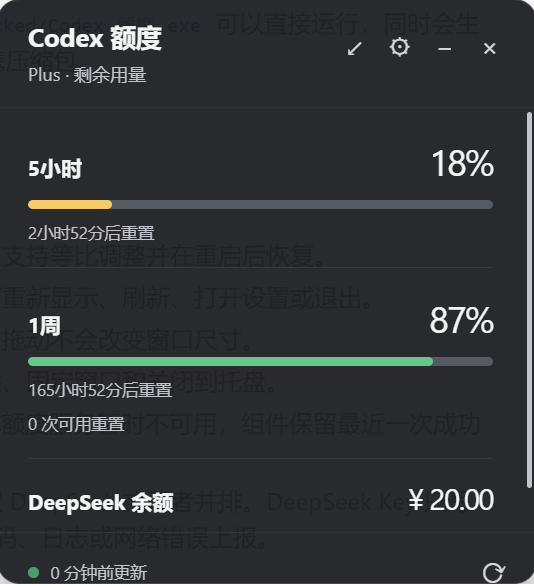
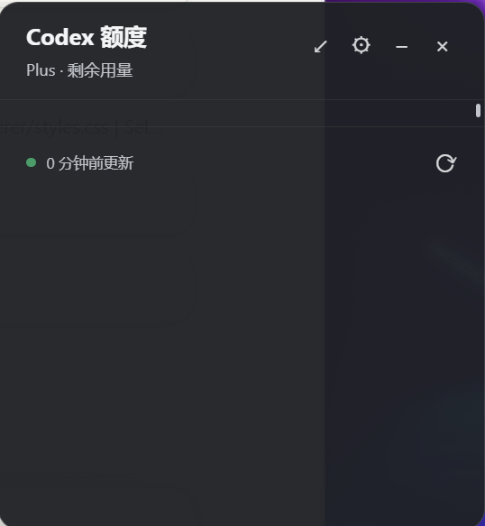

# Codex 额度与 Deepseek余额查看的悬浮组件

一个适用于 Windows 的 Codex 额度悬浮组件：迷你模式常驻桌面，展开后显示短周期/长周期额度、重置倒计时和状态。迷你条使用双圆形进度环，可拖动右下角按比例缩放；额度来源可切换为 Codex、DeepSeek 或两者并排。

## 截图演示





## 下载与直接运行

普通 GitHub 源码页面不会显示 `release-final/`，因为它是本地打包输出目录，并且已加入 `.gitignore`。最终用户不需要安装 Node.js 或 pnpm，直接到 [Releases](https://github.com/Lucy-xiang-a/codex.and.deepseek_quota_tools-v1.02/releases) 下载 Windows x64 便携 ZIP，解压后运行其中的 `Codex 额度.exe` 即可。

便携版不需要管理员权限。设置和最近一次额度快照会保存到当前 Windows 用户的 Electron `userData` 目录；DeepSeek API Key 只在用户在设置页保存后写入本机状态文件。

## 开发

需要 Node.js 与 pnpm。安装依赖并启动：

```powershell
pnpm install
pnpm dev
```

组件会启动本机的 `codex app-server --stdio`，复用 Codex CLI 已有的登录状态，不会把 OAuth token 写入组件配置。

## 构建便携版

```powershell
pnpm package:win
```

本地构建产物位于 `release-final/`：`win-unpacked/Codex 额度.exe` 可以直接运行，同时会生成 `Codex-额度-1.0.0-win-x64.zip` 便携压缩包。发布时将 ZIP 上传到 GitHub Releases，源码仓库不提交整个 `release-final/` 目录。

## 使用说明

- 点击迷你条可展开额度详情。
- 迷你条始终置顶，右下角缩放热区支持等比调整并在重启后恢复。
- 关闭按钮会隐藏到托盘；从托盘可重新显示、刷新、打开设置或退出。
- 标题栏可以像普通窗口一样拖动，拖动不会改变窗口尺寸。
- 详情页右上角支持返回迷你条、打开偏好设置、最小化到任务栏和关闭到托盘；“浮于窗口上方”可在偏好设置中切换。
- 如果 Codex CLI 未安装、未登录或额度服务暂时不可用，组件保留最近一次成功数据并显示连接状态。
- 在偏好设置中可选择仅 Codex、仅 DeepSeek 或两者并排。DeepSeek Key 只写入本机 `state.json`，不会进入源码、日志或网络错误上报。
